# data para para san jose del palmar y alrededores

antes
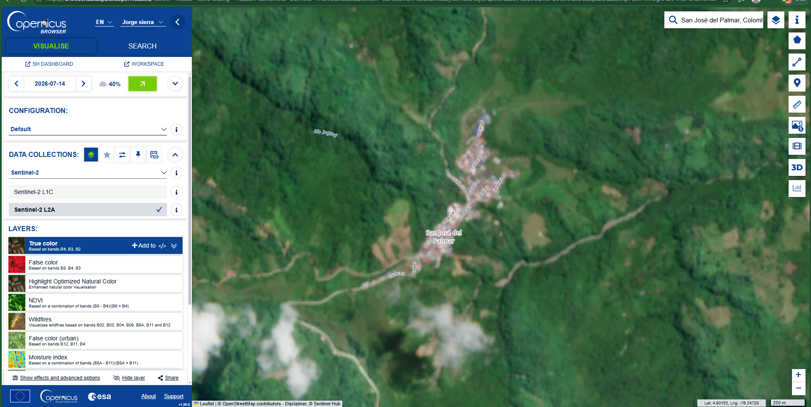

para tomar mas area se decidio tenerlo asi, bordeando nube

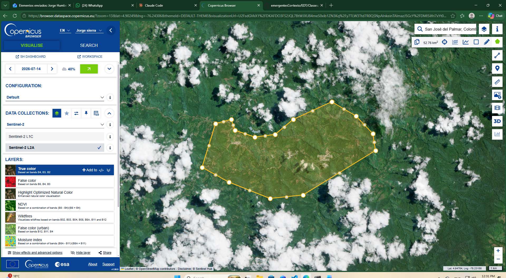

se decidio luego para tener mas vision y con mas aplitud esta area

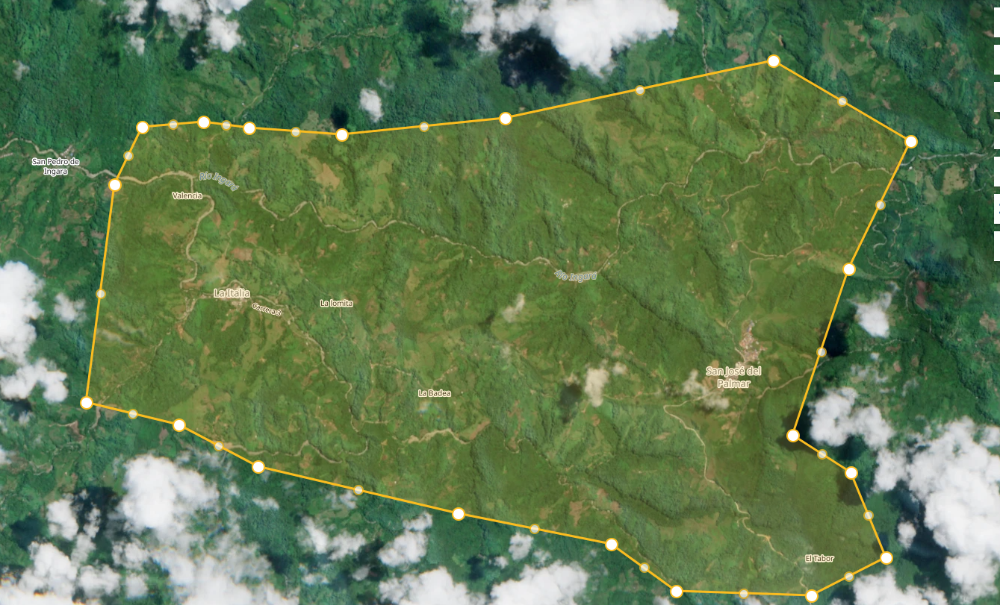
despues

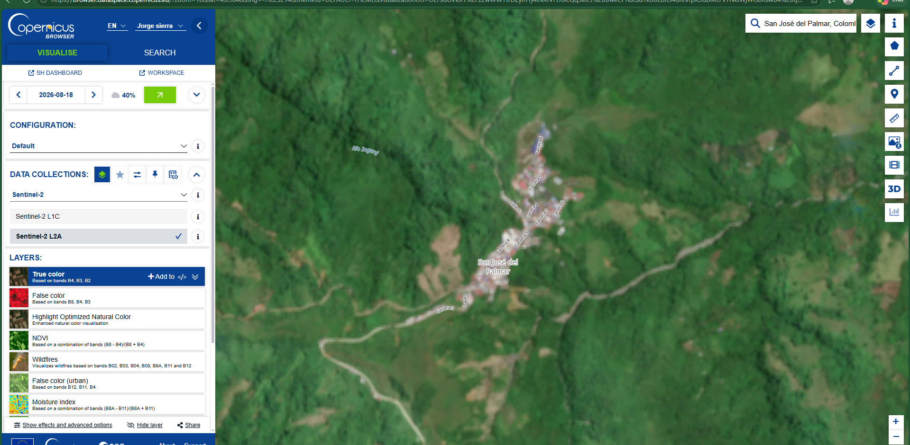

podemos ver que esta mas despejado que la imagen de partida, pero esa imagen era la mas despejdaa de punto de partida
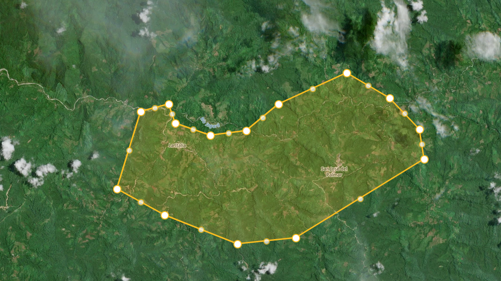

ya con el nuevo area de antes seria asi:
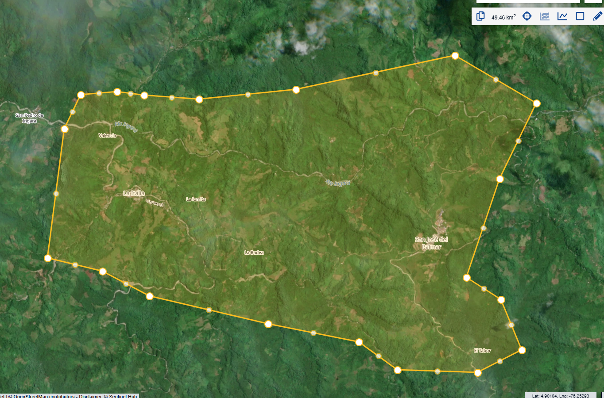

se peude ver como el 18 de agosto era perfecto, no tenia ni una nube, 

aca imagen expandida para que se vea mejor que de verdad habia poca nube en la zona

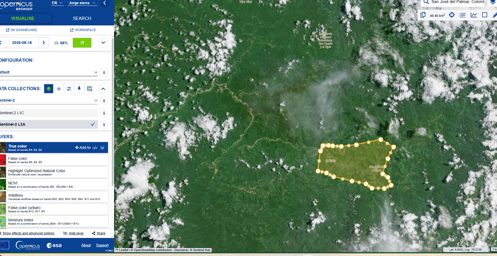

asi se descargo cada uno :

antes 
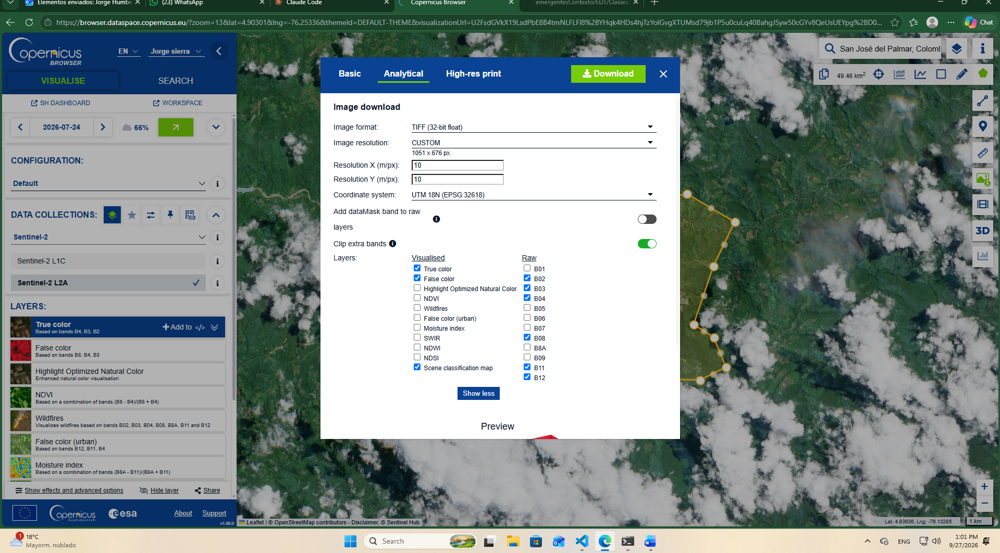

despues

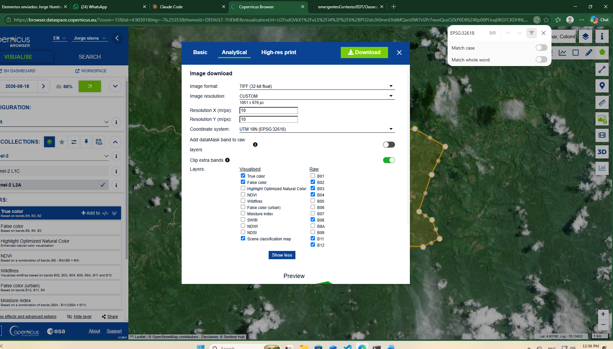

se descargo ademas tambien el roi_palmar.geojson. que se ve  asi:

{"type":"Polygon","coordinates":[[[-76.230526,4.931225],[-76.261339,4.924641],[-76.280136,4.922759],[-76.290779,4.923529],[-76.296015,4.924213],[-76.303053,4.923615],[-76.306229,4.91703],[-76.30949,4.892059],[-76.298847,4.889494],[-76.289749,4.884705],[-76.266747,4.879317],[-76.249151,4.875811],[-76.241684,4.870423],[-76.226149,4.86991],[-76.217566,4.874271],[-76.2216,4.88402],[-76.228294,4.888339],[-76.221857,4.907367],[-76.214733,4.92199],[-76.230526,4.931225]]]}

# primeros pasos en el qgis para el proyecto

ponemos los layers descargados en qgis, cabe aclarar que ya se puso en el sistema colombiano

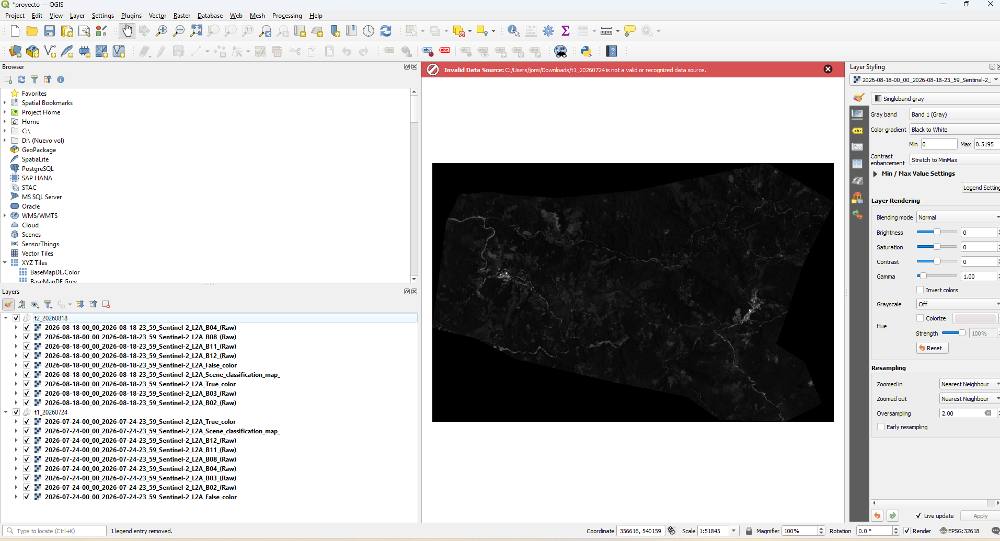

se renombran las capas 

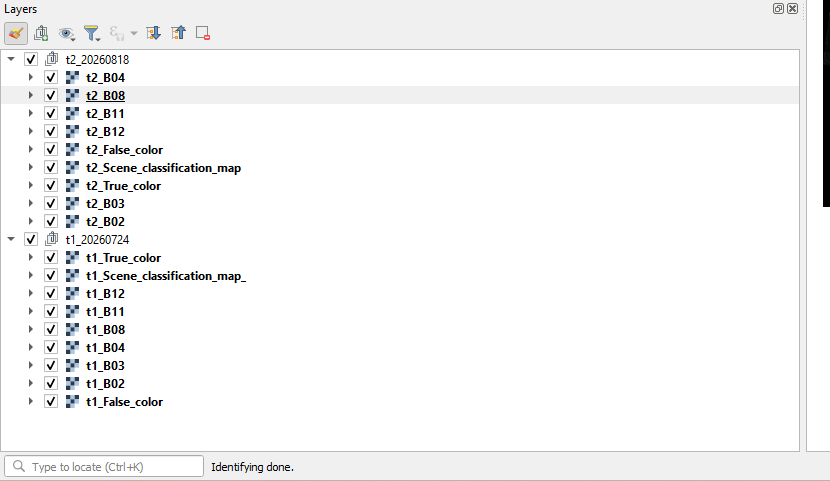

se pone rasters para cada capa excepto true color y false color
para bandas se puso de resampling method lo bilinear mientras que para Scene_classification_map se uso vecino mas cercano 
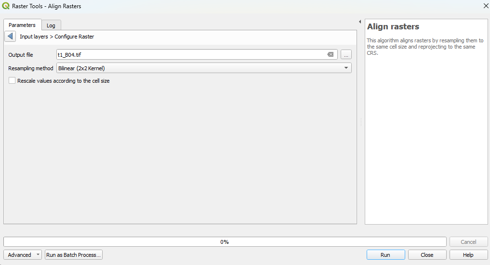

Se corrio para que qeudara con el formato que nos interesa :
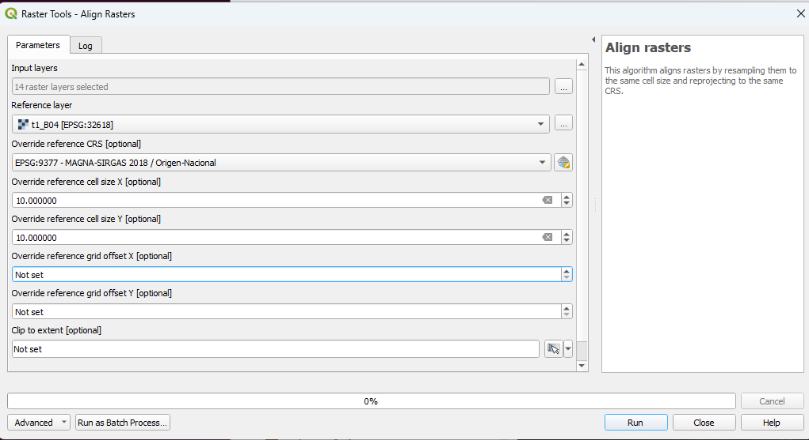

post raster:

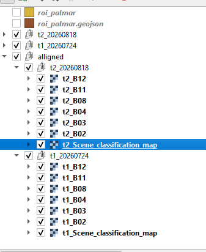

me gusto la comparacion en este momento:

antes:
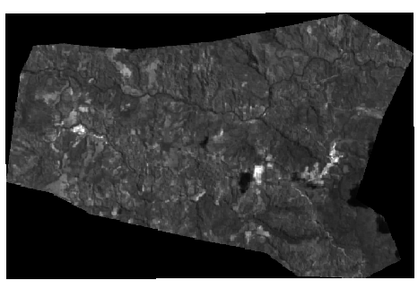

se puede ver ahi un poco de nube, pero fue la mejor que teniamos

despues:
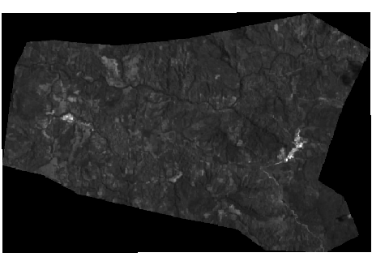

sin nube

aca se estan comparando solo la capa b12 pero se ve bonito, me gusto

como las layers que no estan alligned tienen el mismo nombre que las que si las sacamos del proyecto para que no confundan en calculator:
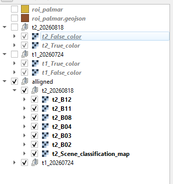
quedo asi

ahora ya con esto calculamos usando raster calculator nubes:

("t1_Scene_classification_map@1" > 0.7 AND "t1_Scene_classification_map@2" > 0.7 AND "t1_Scene_classification_map@3" > 0.7) = 0 AND ("t1_Scene_classification_map@1" < 0.5 AND "t1_Scene_classification_map@2" > 0.7 AND "t1_Scene_classification_map@3" > 0.9) = 0 AND ("t1_Scene_classification_map@1" > 0.3 AND "t1_Scene_classification_map@1" < 0.5 AND "t1_Scene_classification_map@2" > 0.1 AND "t1_Scene_classification_map@2" < 0.3 AND "t1_Scene_classification_map@3" < 0.05) = 0 AND ("t1_Scene_classification_map@1" + "t1_Scene_classification_map@2" + "t1_Scene_classification_map@3") > 0

y quedo con esta mascara 

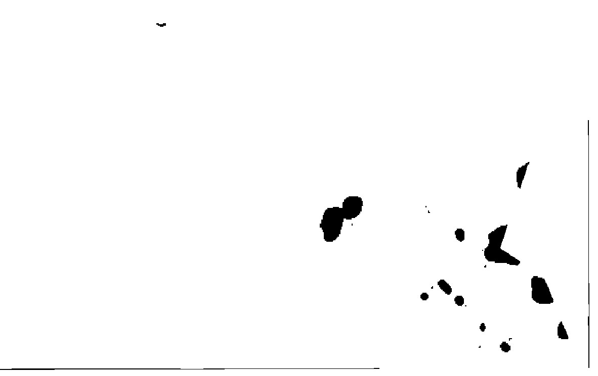

pero le faltaron ocultar nubes, asi que cambiamos la formula y quedo asi:

("t1_Scene_classification_map@1" > 0.7 AND "t1_Scene_classification_map@2" > 0.7 AND "t1_Scene_classification_map@3" > 0.7) = 0 AND ("t1_Scene_classification_map@1" < 0.5 AND "t1_Scene_classification_map@2" > 0.7 AND "t1_Scene_classification_map@3" > 0.9) = 0 AND ("t1_Scene_classification_map@1" > 0.3 AND "t1_Scene_classification_map@1" < 0.5 AND "t1_Scene_classification_map@2" > 0.1 AND "t1_Scene_classification_map@2" < 0.3 AND "t1_Scene_classification_map@3" < 0.05) = 0 AND ("t1_Scene_classification_map@1" + "t1_Scene_classification_map@2" + "t1_Scene_classification_map@3") > 0 AND "t1_B02@1" <= 0.1

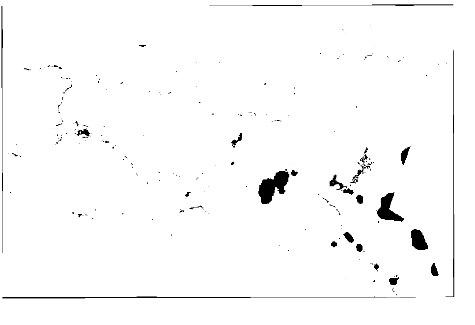

el unico cambi oen la formula es "t1_B02@1" <= 0.1, ya que en vezx de usar la clasifcacion que hizo la union europea, al ver visualmente que  no tomaba todo bien, usamos informacion del mismo satelite, para ser mas exacto de la banda azul

los otros valores como el 0.7 0.5 son valores que usamos a para cortar, c0k0 decir es myor as 0.7 significa que toca ponerlo blanco, ya que en base a la paleta de colores estándar de Sentinel Hub para el SCL, pasada de 0–255 a 0–1. la nube media es 192/255 = 0.75 y el cirro es 100/255 = 0.39, 200/255 = 0.78 y 255/255 = 1.

aca pasa algo curioso, en t2 no aplicamos lo de la banda azul, porque? porque los deslizamientos se reflejan en ese azul, ya que no hay vegetacion, no nos importaba en el antes porque queremos saber donde habia vegetacion en primera instancia, y poner ese azul si nos ayuudaba a quitar nubes que no salian en la clasificacion que hace la SCL, asi no nos importaba donde no habia en t1 ,para t2 si importa saber donde no hay, ya que donde habia vegetacion y ahora no es porque hubo deslizamientos, ahi hay mas factores que se van a ver mas adeltante porque pudo haber incendio u otra causa de la perdida de vegetacion.

la mascara de t2: 

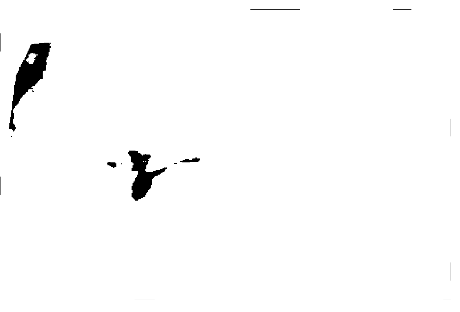

aca aunuqe cuando comparamos pareciera que no deberia haber problemas o algo enmascarado (ver la siguiente imagen), cuando nos pusimos  a ver si la mascara estaba bien nos dimos cuenta que lo que habia detectado en la imagen era Cirro, lo cual podia daniar la muestra y dar falsos positivos 

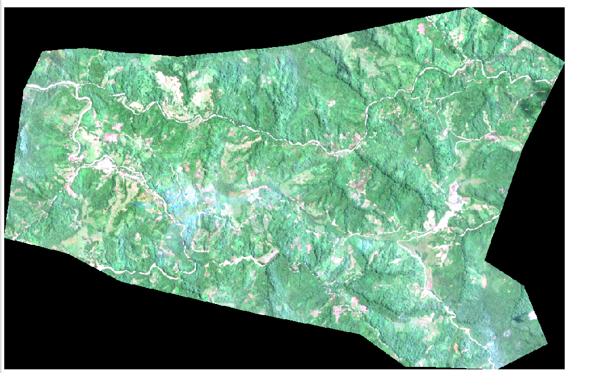

dando como parte valida esto:

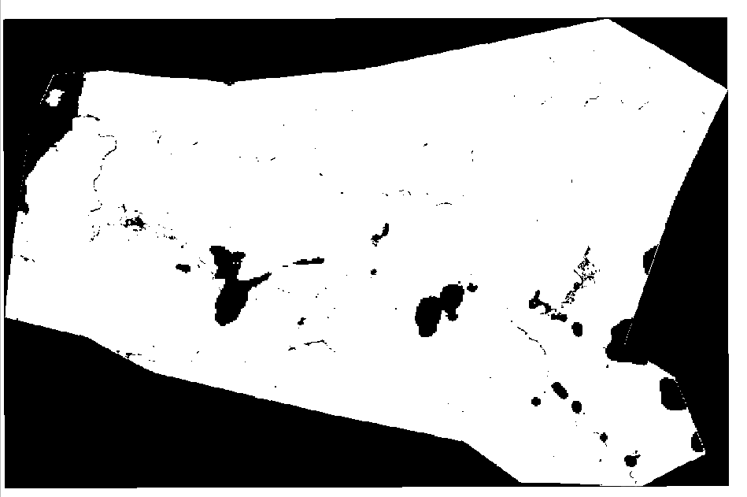

la intereseccion de als areas limpias de la parte de t1  y la parte de t2, 

## calculo de indices

ya con nustro espacio de trbajo organizado ahora si vamos a darle con los indices, nosotros vamos a usar NIR  y NDVI

dando como resultado esto: 

en t1: 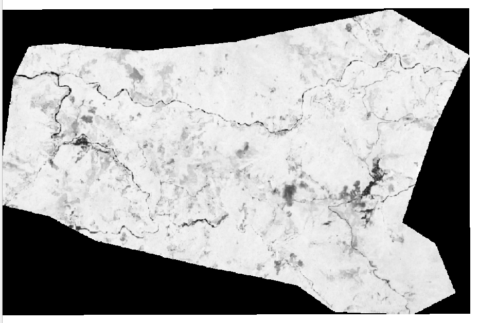
("t1_B08@1" - "t1_B04@1") / ("t1_B08@1" + "t1_B04@1")
en t2: 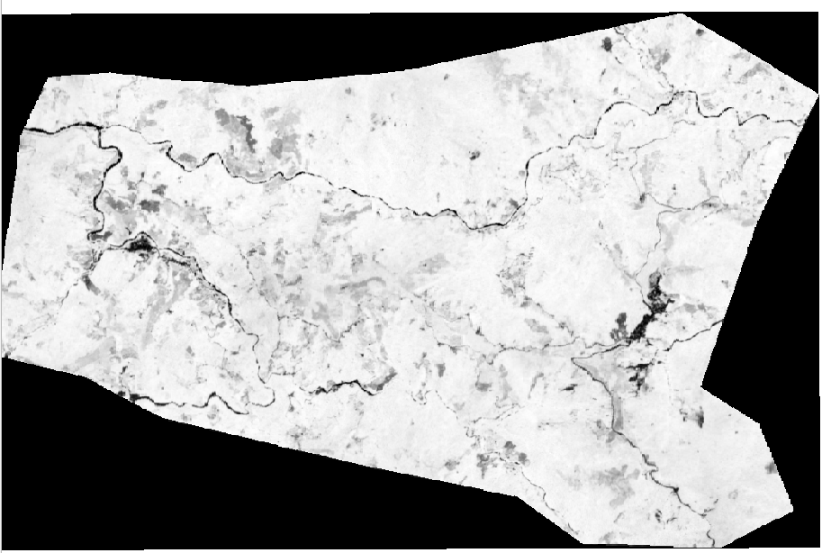
("t2_B08@1" - "t2_B04@1") / ("t2_B08@1" + "t2_B04@1")
la diferencia en la parte valida: 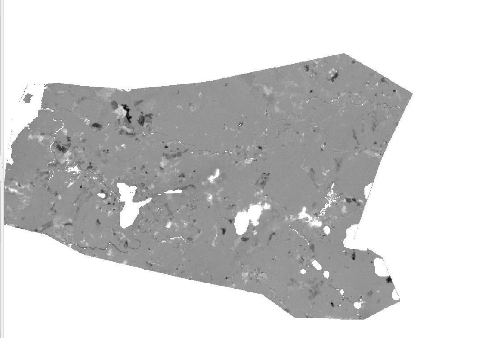
("t2_NDVI@1" - "t1_NDVI@1") / ("valid@1" = 1)

Gris medio (casi todo) = sin cambio.

Manchas oscuras/negras = pérdida de vegetación, o sea deslizamientos candidatos. Fíjate en el grupo del noroeste, arriba a la izquierda, al norte del río: ese es el conglomerado más grande que salió en el informe.

Manchas grises claras = ganancia de vegetación (rebrote, cultivos).

Huecos blancos = sin dato: las nubes, sombras y zona urbana que quitó la máscara (incluida la nube que encontraste, en el centro).

